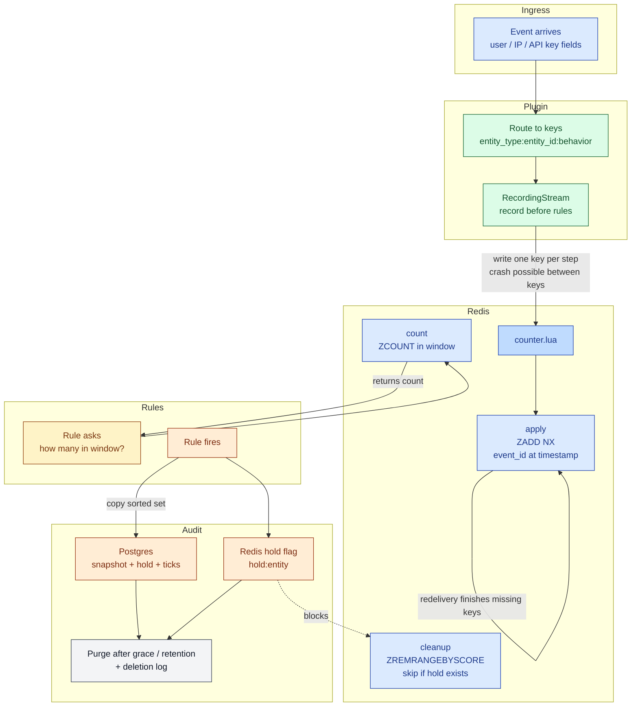

# osprey-velocity-counter

## What this is

A velocity counter answers a plain question: how many times has this user, IP address, or API client done something recently?

Trust and safety teams use that count to spot abuse and fraud. A person who sends one message looks different from a person who sends a hundred in a few minutes. The same idea applies to logins, signups, and other repeated actions.

[Osprey](https://github.com/roostorg/osprey) evaluates trust-and-safety rules. It has no built-in sliding window. This project adds one. When an event arrives, the plugin records a tick for each entity on that event. A rule later asks how many of those ticks fall inside a time window.

The hot path is a Redis sorted set, updated by a short Lua script. A TLA+ model states the counting rules, and a model checker tests them. Postgres keeps a frozen copy when a case needs to be held. A small load test compares that Redis write with the same kind of write in Postgres.

## What problem it solves

A rule is only useful if the count is trustworthy. A retried event must not look like two events. A worker that dies halfway through an event must not lose the rest of it, and must not rewrite the part it already finished.

### A simple example

The question is: how many messages has this user sent in the last 5 minutes?

An event arrives with user `42` and IP `10.0.0.1`. The plugin writes one tick on each key:

```text
user:42:message_sent
ip:10.0.0.1:request
```

A rule asks `VelocityCount` for entity `user` `42`, behavior `message_sent`, and a window of 300 seconds. The answer is how many stored timestamps sit inside that window. The IP key gets its own count, because many accounts can share one address.

A second event is an API call from key `bot-9`, still from user `42` and the same IP. The user field is marked population-sensitive, so that tick is stored as `api-client:bot-9:message_sent`. It is not stored again under `user:42`. The IP key still records it.

The checked-in demo uses the same two events with a 10-second window. The 5-minute window above is the same mechanism with a longer window.

### Why double-counting and crash recovery matter

Each key stores an event id once. Writing that id again leaves the original timestamp in place and does not add a second tick. A redelivery cannot inflate the count on a key that already has it.

The worker writes one key per step. It can crash after the user key and before the IP key. A later delivery writes the missing key and leaves the finished key alone. The model treats completion as true when redeliveries keep happening. The plugin raises on a failed write so the system around it can retry the unfinished key. This package does not itself schedule that retry.

## How it works

### Components

`capture` and `purge_due` run when a caller invokes them. The diagram shows that path.



| Piece | File | Role |
| --- | --- | --- |
| Model | `VelocityCounter.tla` | States the rules TLC checks |
| Lua script | `osprey_velocity/counter.lua` | One Redis key: apply, count, cleanup |
| Plugin | `osprey_velocity/plugin.py` | Chooses the keys and calls the script |
| Rule function | `osprey_velocity/udf.py` | `VelocityCount` reads a count. It does not write one |
| Entry point | `osprey_velocity/register_plugins.py` | Registers the plugin with Osprey |
| Audit | `osprey_velocity/audit.py` | Snapshot, hold, and soft delete in Postgres |

### TLA+ model

`VelocityCounter.tla` is a small instance, not a load test. Two events share one user, one IP, and one API key. Each event is a human visit or an API call.

The worker writes one key per step and can crash between keys. A later delivery writes the missing key and leaves the finished key alone. An API call is recorded under `api-client` and the IP key. The user key stays empty of that event. A count is how many stored timestamps sit inside the requested window. Cleanup deletes only timestamps the longest window can no longer see.

Completion is checked under strong fairness: redeliveries of each event, and the apply step for each event and key, keep being attempted. Weak fairness on those steps was not enough, because a crash can interrupt one key and a different event can still make progress. Crashes, the clock moving forward, and cleanup are not fair. A finite number of crashes is still allowed. The implementation relies on the system around it to redeliver. The model does not make Redis or Python exist.

### Redis Lua script

`osprey_velocity/counter.lua` handles one key per call. The caller chooses the key.

- `apply` stores the event id at its own timestamp. If that id is already in the key, the timestamp stays where it is.
- `count` returns how many stored timestamps sit inside `now - window < timestamp <= now`.
- `cleanup` deletes timestamps at or before `now - retention`. If Redis has `hold:{entity_type}:{entity_id}`, cleanup deletes nothing for that key.

### Osprey plugin

The plugin reads `VELOCITY_COUNTERS` and calls the Lua script. A missing field is skipped. A missing traffic-source stamp counts as a human visitor. The value `api` is matched without regard to case.

`RecordingStream` records each event before the rules see it. `VelocityCount` only reads. A Redis error on that read returns 0 and logs an error, so a rule that is waiting for a high count does not fire on a blind read. A Redis error on the write is logged and raised, so the delivery can retry the unfinished key.

`RecordingStream` does not replace Osprey's Kafka source. Wrap the stream your own input hook already returns. The demo is separate. It sets `OSPREY_INPUT_STREAM_SOURCE=plugin` and `VELOCITY_EVENTS_FILE`, so this package reads two events from a file.

### Holds and the audit path

The audit functions live in `osprey_velocity/audit.py`. They are Python calls. The demo does not call them, and no SML effect calls them for you.

When a rule fires, `capture` reads one Redis key, writes a snapshot header and the ticks into Postgres, and places an open hold on the entity. Ticks that arrive later stay out of that copy. Cleanup leaves the held entity's Redis ticks in place.

An analyst can call `place_hold` before any rule has fired. That writes a hold and copies nothing.

`clear` keeps the rows for `VELOCITY_HOLD_GRACE` seconds. `confirm` keeps them for `VELOCITY_SNAPSHOT_RETENTION` seconds. There is no default for either duration. After the matching duration, `purge_due` marks the rows purged and a deletion log records who destroyed them. Nothing in this package runs `purge_due` on a timer. The caller invokes it.

Postgres is the record of the hold. Redis key `hold:{entity_type}:{entity_id}` is a flag so cleanup can skip the entity without asking Postgres. The flag is set after the Postgres commit.

## Running it

### Model checker

Java 11 or newer is required. The script downloads the TLA+ tools on first run.

```bash
./scripts/check.sh
```

If `java` is not on `PATH`, set `JAVA` to the JDK binary.

### Unit tests

```bash
python3 tests/test_counter.py
python3 tests/test_plugin.py
python3 tests/test_audit.py
python3 tests/test_bench.py
```

`redis-server` must be on `PATH` for `tests/test_counter.py`. That test starts its own server and stops it.

`tests/test_audit.py` needs Docker and `psycopg`. It starts its own Postgres and Redis and stops them.

`tests/test_plugin.py` and `tests/test_bench.py` do not start a server.

### Demo

Docker is required. The script clones Osprey into `~/.cache/osprey-velocity-demo` (or `$OSPREY_DIR`) and builds the worker image.

```bash
./demo/up.sh
```

The demo feeds two events. The first is a human visit and lands on `user:42:message_sent` and `ip:10.0.0.1:request`. The second is an API call and lands on `api-client:bot-9:message_sent` and the same IP key. It does not add event `2` to the user key. `demo/check.py` checks those Redis entries and that the worker log mentions `UserMessages` and `IpRequests`.

The demo sets `VELOCITY_EMPTY_LABELS=1` because this Osprey build requires a labels provider and the demo has none. Leave that variable unset when a real labels plugin is installed. The hook can win and replace that plugin.

### Benchmarks

`bench/harness.py` offers the same dedup-and-tick to Redis and to Postgres. Docker is required. The harness starts both servers and stops them.

```bash
python3 bench/harness.py
```

`redis-benchmark` and `pgbench` do not run this operation, so the harness does. On the run in `bench/results.md`, Redis stayed near the offered rate through 10,000 events per second, with p99 under 25 ms. Postgres kept up through 5,000 per second. At 10,000 per second its p99 was over a second. The chart is `bench/latency.svg`.

## Configuration

`VELOCITY_COUNTERS` is a comma-separated list of `json.path:entity_type:behavior:flag`. The flag is `1` or `0`. A `1` means an API call rewrites that field to the entity type `api-client`, using the id at `VELOCITY_API_KEY`. A `0` keeps the entity type from the config.

```text
user_id:user:message_sent:1,ip:ip:request:0
```

That is the demo's list. The user field is population-sensitive. The IP field is not.

| Variable | Meaning |
| --- | --- |
| `VELOCITY_COUNTERS` | Fields to count. Empty means no keys. |
| `VELOCITY_TRAFFIC_SOURCE` | JSON path of the traffic-source stamp. Default `traffic_source`. |
| `VELOCITY_API_KEY` | JSON path of the API client id. Default `api_key`. |
| `VELOCITY_RETENTION` | How many seconds a tick may stay in Redis. Default `0`, which retains nothing. The demo sets `3600`. |
| `REDIS_URL` | Redis for the counter. Default `redis://127.0.0.1:6379/0`. |
| `VELOCITY_HOLD_GRACE` | Seconds a cleared hold is kept. No default. |
| `VELOCITY_SNAPSHOT_RETENTION` | Seconds a confirmed hold is kept. No default. |
| `VELOCITY_EVENTS_FILE` | When set, the plugin's input hook reads this file. When unset, the hook returns nothing and leaves the stream to another plugin. |
| `VELOCITY_EMPTY_LABELS` | Set to `1` only for the demo. |
| `OSPREY_INPUT_STREAM_SOURCE` | The demo sets this to `plugin` so Osprey uses the file hook. |

## Current status and limitations

This is a working prototype and a public showcase of the design. It is not a hosted service, and it does not ship a UI.

Keys look like `entity_type:entity_id:behavior`. An entity id that contains `:` collides with that format. Hold detection uses the same split, so a held entity with a colon in its id is not recognized. Change the separator if that id shows up.

The model proves that every key is eventually written only under strong fairness: redeliveries keep occurring. The implementation raises on a failed write and depends on Kafka, or whatever is delivering the event, to send it again.

A failed count returns 0. A stored zero and a failed read look the same. A rule that fires when the count is at least some N stays quiet during an outage. A rule that fires when the count is exactly 0 will fire during an outage.

`capture` and `purge_due` run only when something calls them. A crash after the Postgres commit and before the Redis hold flag lets cleanup remove ticks until the next `capture` or `place_hold` writes the flag again.

The benchmark is one run on one machine. Both servers are Docker containers on localhost, the stores start empty, and 100 keys share the traffic. It is not a single hot key, and it is not a growth test. The measured numbers are in `bench/results.md`.
