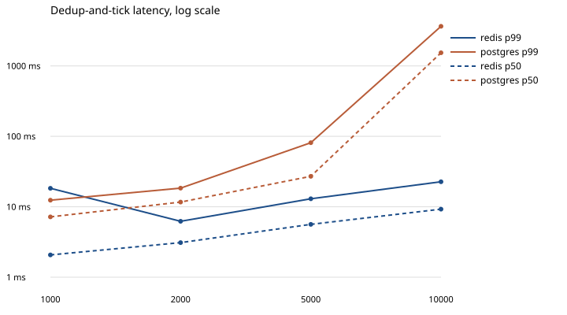

# Redis versus Postgres

Each event is one dedup-and-tick for one of 100 keys.
Redis runs `counter.lua` `apply` (`ZADD NX`).
Postgres takes `pg_advisory_xact_lock` on the key, then `INSERT ... ON CONFLICT DO NOTHING`.
Each level starts from an empty store and is offered for 3 seconds in 50 ms bursts.
Latency is the time from when the client starts the operation until it finishes,
including waiting for a free connection from a pool of 32.
A store stops at the first level whose p99 is over one second.
Achieved rate is completed calls divided by wall time, including calls still in flight at the end of the offer.
A full sample count and a low achieved rate means those calls finished late. It does not mean they were dropped.
The 100 keys share the traffic. This is not one hot key.
Postgres does not use SELECT FOR UPDATE. A missing row does not lock the gap, so the lock is pg_advisory_xact_lock and the primary key rejects the duplicate.
Both servers are Docker containers published on localhost, so both pay that port hop.
`redis-benchmark` and `pgbench` are not used. They do not run this operation.

| store | target /s | achieved /s | p50 | p95 | p99 | errors | samples |
| --- | --- | --- | --- | --- | --- | --- | --- |
| redis | 1000 | 980 | 2.07 ms | 2.77 ms | 18.28 ms | 0 | 2950 |
| redis | 2000 | 1961 | 3.10 ms | 5.25 ms | 6.22 ms | 0 | 5900 |
| redis | 5000 | 4904 | 5.63 ms | 11.47 ms | 13.00 ms | 0 | 14750 |
| redis | 10000 | 9805 | 9.26 ms | 19.37 ms | 22.65 ms | 0 | 29500 |
| postgres | 1000 | 981 | 7.19 ms | 10.70 ms | 12.39 ms | 0 | 2950 |
| postgres | 2000 | 1960 | 11.67 ms | 17.79 ms | 18.40 ms | 0 | 5900 |
| postgres | 5000 | 4950 | 27.04 ms | 58.67 ms | 81.28 ms | 0 | 15000 |
| postgres | 10000 | 5140 | 1538.03 ms | 2736.66 ms | 3649.58 ms | 0 | 30000 |

